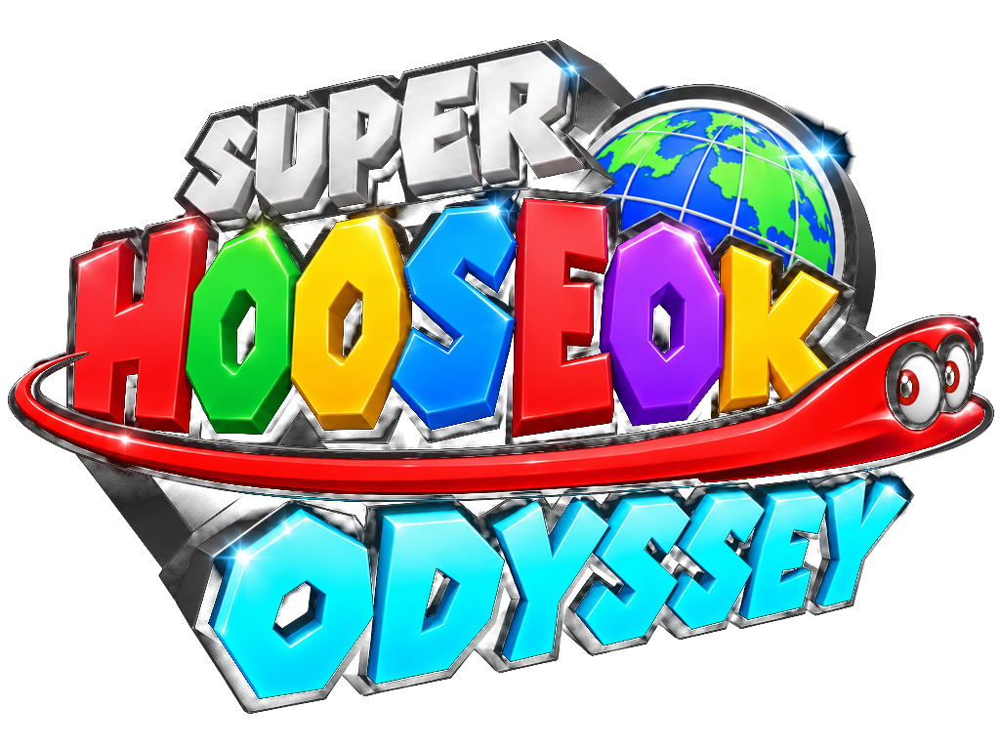
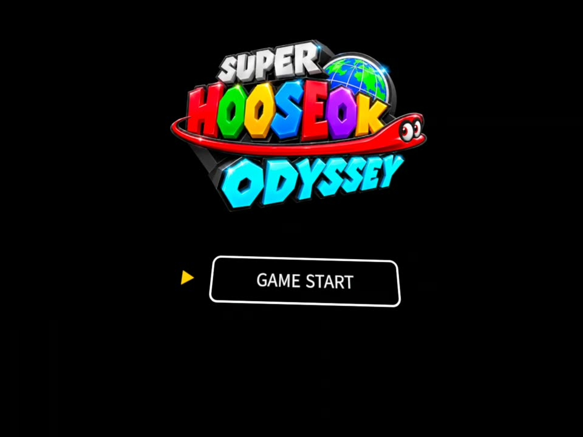
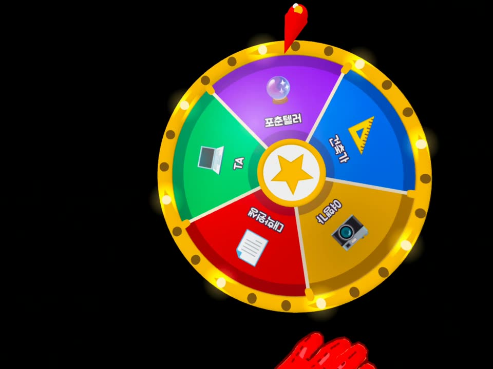
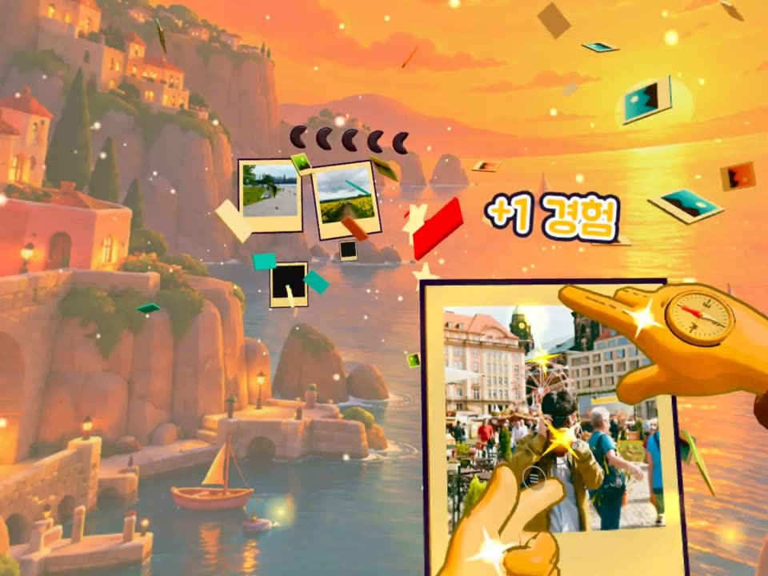
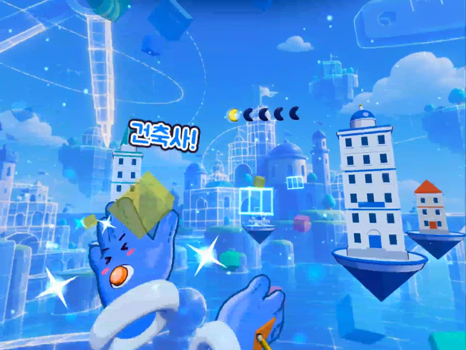
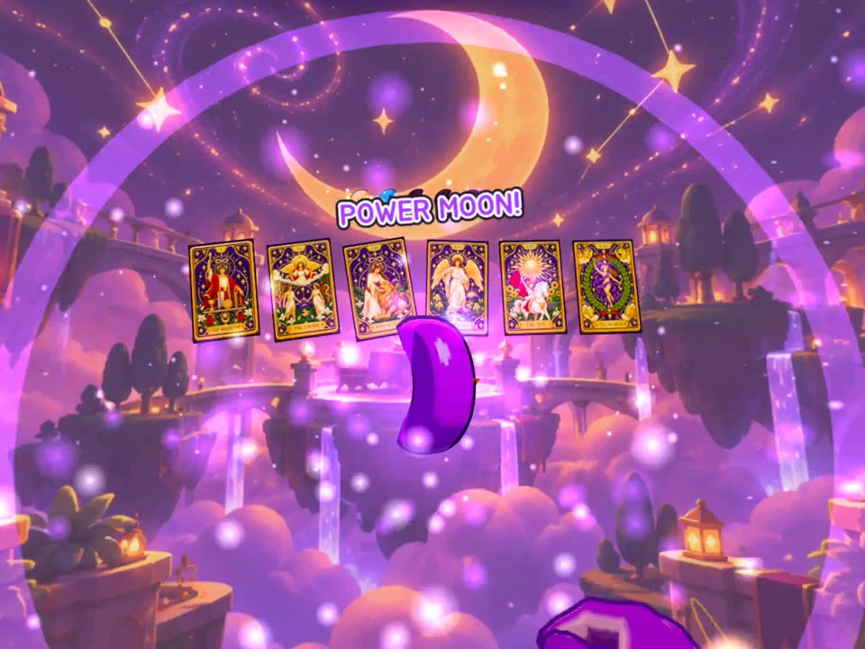
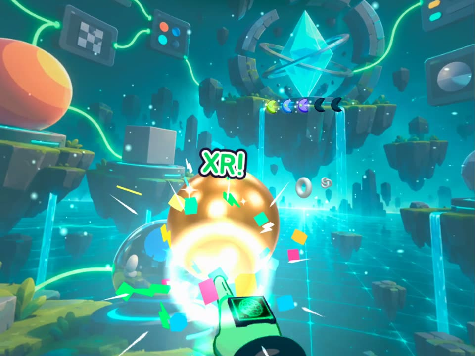
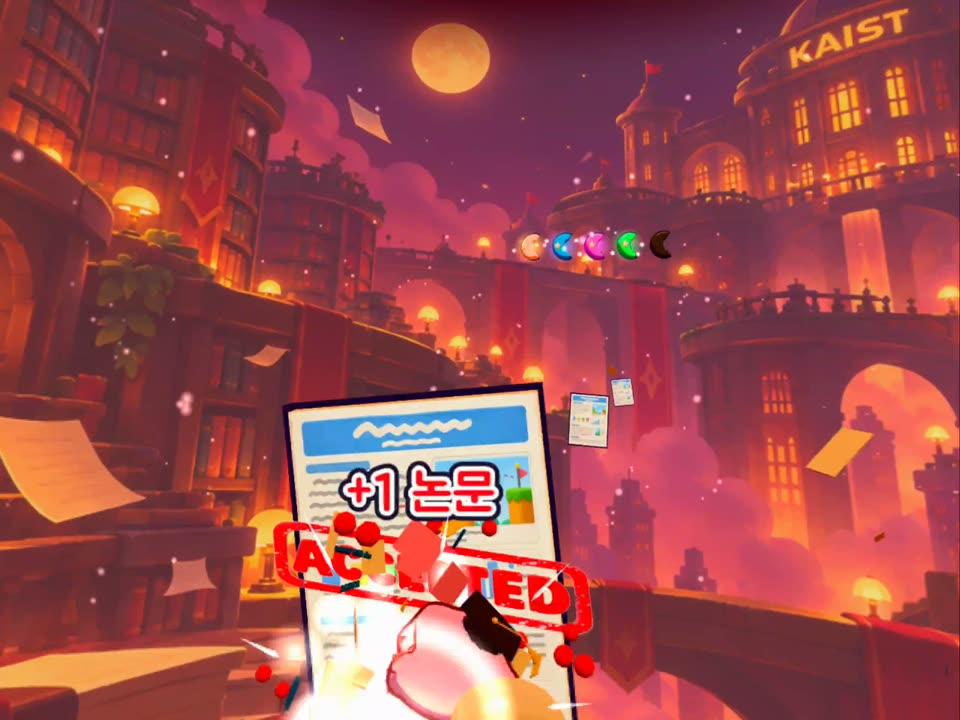
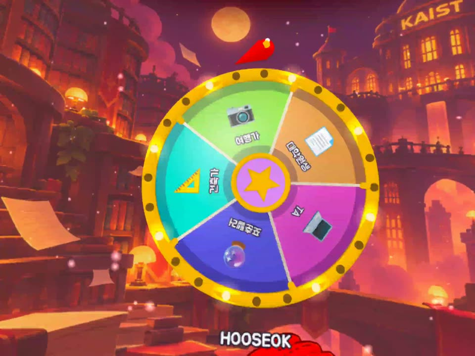
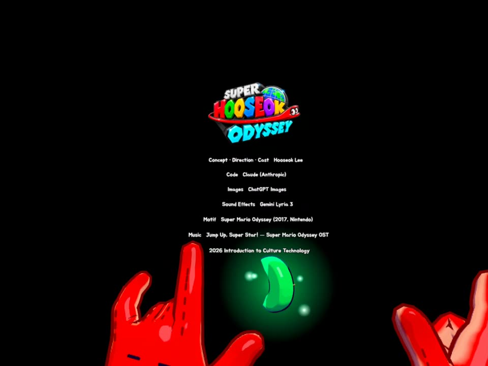

<p align="center">
  
</p>

<p align="center">
  <b>A hand-tracking WebXR game about the many lives one person tries on.</b><br />
  Hooseok Lee · Introduction to Culture Technology (2026)
</p>

<p align="center">
  <a href="https://hoodess.github.io/super-hooseok-odyssey/"><b>▶ Play in your browser</b></a>
</p>

<p align="center">
  
  
  
  
  
  
  
  
  
</p>

## About the Project

I wanted to tell the story of the careers I have had, or once hoped to have, as my own life journey — my odyssey. I turned it into a simple VR game and planned it with Nintendo's well-known title *Super Mario Odyssey* as its motif. I made five roles — travel writer, architect, tarot reader, technical artist, and graduate student — into their own stages, and designed the art and staging to fit the character of each role.

As shown in the ending credits, all development was done in Claude Code, while the images were generated with ChatGPT and the sound effects with Gemini, using each one's models.

Enjoy! Because we are all superstars.

## How It Plays

In *Super Mario Odyssey*, Mario throws his cap to "capture" and become something else. Here the cap is a pair of gloves: every spin of the roulette puts a new pair on your hands, and with it a new version of you.

1. **Title** — poke **GAME START** with a fingertip. The first roulette spins by itself and the music kicks in.
2. **Roulette** — the wheel lands on a role and the gloves transform.
3. **Play** — targets fly at you; hit six of them with your hands.
4. **Power Moon** — the stage is cleared and a moon joins the row at the top.
5. Press the **button on the back of your left hand** with your right index finger to spin again.
6. After all five roles the wheel never stops: the worlds flash by, everything whites out, and the logo and credits close the journey.

| # | Role | Color | Targets | On a hit |
|---|---|---|---|---|
| 1 | Traveler | Yellow | Blank polaroids | Shutter flash, a real travel photo develops and joins a 3 × 2 gallery |
| 2 | Architect | Blue | Glowing wireframe blocks | The block fills in, flies off, and a building rises in the city |
| 3 | Fortune Teller | Purple | Tarot card backs | The card flips to a real tarot card and joins a row of six |
| 4 | Technical Artist | Green | Gray spheres and tori | Each takes a new material in turn: polished bronze, a glowing orb, a wireframe |
| 5 | Grad Student | Red | Stacks of papers | An ACCEPTED stamp and a burst of paper |

## Requirements

- **Meta Quest 3** (or another WebXR headset with hand tracking) using the built-in browser.
- Enter VR with the **ENTER VR** button on the page. Entering through the page is what lets the browser play sound from the first run.
- On a desktop browser the game runs in **director mode** (no headset): targets are hit automatically and the keyboard drives the show.

### Director mode keys

| Key | Action |
|---|---|
| Space / Enter | Start · spin the roulette |
| 1 – 5 | Jump to a role |
| M | Power Moon |
| F | Finale |
| 0 | Back to the title |
| A | Auto-hit on / off |
| C | Cinematic camera |
| G | Show / hide the gloves |
| H | Hide the help and HUD |

## Run It Locally

```bash
npm install
npm run dev      # https://<your LAN IP>:5173, open it on a Quest on the same Wi-Fi (accept the certificate warning)
npm run build    # production build into dist/
```

WebXR needs a secure context. Without Wi-Fi, connect the Quest over USB instead and open `http://localhost:5173` in its browser:

```bash
npm run dev:usb
adb reverse tcp:5173 tcp:5173
```

Every push to `main` is built and deployed to GitHub Pages by GitHub Actions.

The soundtrack is not part of this repository for copyright reasons, so the online version plays without music. To hear it locally, put your own copy of "Jump Up, Super Star!" at `assets/bgm/jump_up_super_star.mp3`.

## Built With

- [three.js](https://threejs.org/) and WebXR hand tracking, bundled with [Vite](https://vitejs.dev/)
- Toon shading, outlines, halftone transitions and particle effects written for this project

```
src/
  main.js       state machine, input, XR session and render loop
  roles.js      the five roles: colors, backgrounds and targets
  texts.js      every on-screen string (hit texts, credits)
  roulette.js   the toy roulette wheel
  targets.js    flying targets, hits and the per-role galleries
  glove.js      the capture gloves on the tracked hands
  world.js      sky, panorama, island, fog and lighting
  title.js      title screen
  ending.js     ending credits
  fx.js         flashes, halftone wipe, whiteout, particles
  audio.js      sound effects and music
assets/         backgrounds, glove textures, tarot cards, photos, sounds
```

## Credits

| | |
|---|---|
| Concept · Direction · Cast | Hooseok Lee |
| Code | Claude (Anthropic), via Claude Code |
| Images | ChatGPT Images |
| Sound effects | Gemini Lyria 3 |
| Motif | *Super Mario Odyssey* (2017, Nintendo) |
| Music | "Jump Up, Super Star!" from the *Super Mario Odyssey* soundtrack |

Open-source assets and their licenses are listed in [CREDITS.md](CREDITS.md).

*Super Mario Odyssey* and "Jump Up, Super Star!" belong to Nintendo. This is a non-commercial student project made as an homage, and it is not affiliated with or endorsed by Nintendo.
